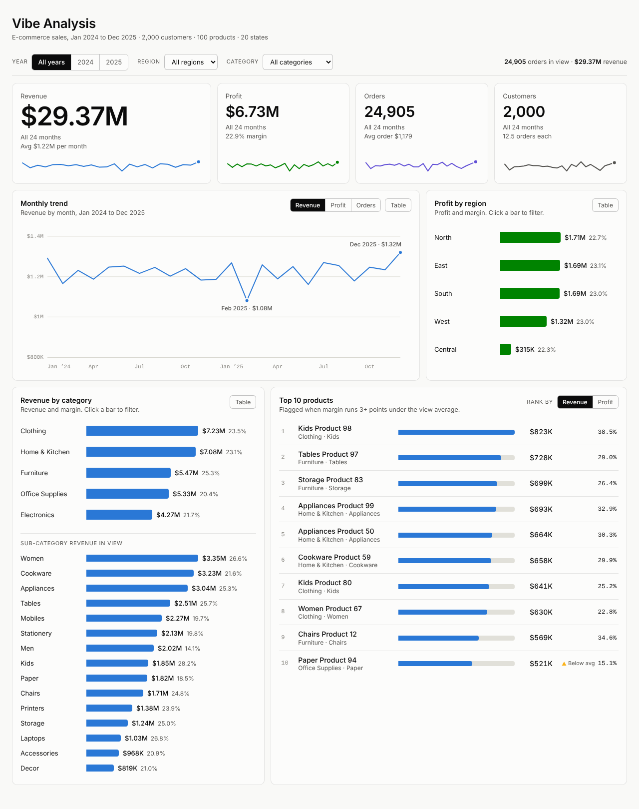
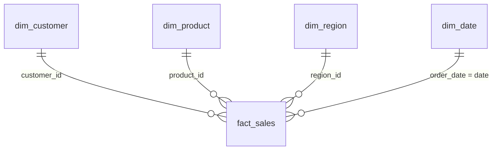

# Vibe Analysis

From raw business data to a star schema to an interactive dashboard, built with Claude as the analyst's assistant.

An e-commerce company wants to understand its sales, profit, customers, products and regional performance. This project takes four messy CSV exports, profiles them, cleans them, models them as a star schema and publishes an interactive HTML dashboard.



## What is in the repository

```
vibe-analysis/
├── data/
│   ├── raw/        the four source CSVs, untouched
│   ├── clean/      the star schema: fact_sales + 4 dimension tables
│   └── logs/       audit trail of every row-level fix
├── scripts/
│   ├── clean_data.py        raw CSVs -> star schema (data/clean)
│   └── build_dashboard.py   star schema -> dashboard/index.html
├── dashboard/
│   ├── dashboard_template.html
│   └── index.html           self-contained, open it in any browser
└── docs/
    ├── data_quality_and_cleaning.md   what was wrong and what was done
    └── data_model.md                  schema diagram and data dictionary
```

## Run it

```
pip install -r requirements.txt
python scripts/clean_data.py
python scripts/build_dashboard.py
```

Then open `dashboard/index.html`. `clean_data.py` ends with integrity checks: every key in `fact_sales` must resolve to a dimension row, and `order_id` must be unique.

## The data

| File | Rows | Columns | Grain |
|---|---|---|---|
| orders_raw.csv | 25,050 | 10 | one row per order (one product per order) |
| customers_raw.csv | 2,010 | 6 | one row per customer |
| products_raw.csv | 100 | 6 | one row per product |
| regions_raw.csv | 20 | 4 | one row per state |

## Data quality findings

| Table | Problem | Count | Treatment |
|---|---|---|---|
| orders | Exact duplicate rows | 50 | Removed |
| orders | Blank `customer_id` or `product_id` | 60 + 35 | Rows removed |
| orders | `order_date` is the text `not_a_date` | 10 | Date left blank, row kept, `is_invalid_date` flag |
| orders | Negative quantity (returns) | 15 | Kept, `is_return` flag |
| orders | Sales below cost at 15% or 20% discount | 571 | Kept (a business finding, not an error) |
| customers | Duplicate customer rows | 10 | Removed |
| customers | Order placed before the signup date | 1,856 customers | Signup date moved back to first order |
| products | Category with wrong case or trailing space | 12 | Standardized |
| products | Category contradicts the sub-category | 12 | Corrected from the sub-category |
| regions | None found | 0 | Copied unchanged |

Details, reasoning and the assumptions behind each decision are in [docs/data_quality_and_cleaning.md](docs/data_quality_and_cleaning.md).

Row counts through the pipeline: orders 25,050 to 25,000 (duplicates) to 24,905 (missing IDs). Customers 2,010 to 2,000.

## Star schema

`fact_sales` sits in the centre with four dimensions around it.



Column-level definitions are in [docs/data_model.md](docs/data_model.md).

## Dashboard

A single HTML file with the data embedded, so it needs no server.

- **Figures:** revenue, profit, orders and customers, each with a trend line. With 2025 selected they show the change against 2024.
- **Charts:** monthly trend (revenue, profit or orders), profit by region, revenue by category with a sub-category breakdown, and the top 10 products ranked by revenue or profit. Products whose margin is 3 or more points below the current average are marked.
- **Filters:** year, region and category. Every figure recalculates together, and clicking a region or category bar applies that filter.
- **Extras:** a table view behind every chart, keyboard access, light and dark themes, and a phone layout.

## What the data says

Figures cover the 24,905 cleaned orders.

- **Scale:** $29.37M revenue and $6.73M profit, a 22.9% margin, across 2,000 customers.
- **Growth:** flat. Dated orders brought in $14.65M in 2024 and $14.71M in 2025, and the margin was 22.9% in both years. Monthly revenue stays between about $1.08M and $1.32M, and February is the only recurring dip.
- **Regions:** North ($1.71M profit), East ($1.69M) and South ($1.69M) are within 1.4% of each other. West and Central trail only because they have fewer states, 4 and 1. Average profit per state is nearly the same in every region, between $315K and $342K.
- **Products:** the top 10 earn $6.63M, 22.6% of revenue. Kids Product 98 leads at $823K. Revenue is spread thinly, since no product exceeds 2.8% of the total.
- **Margin:** profit follows list-price margin almost exactly, because the average discount is about 5% for every product. Two top-revenue products, Cookware Product 89 (9.6%) and Mobiles Product 66 (12.1%), earn far less than the 22.9% average. Fixing their pricing or cost would matter more than limiting discounts.

## Limitations

- The data is synthetic: generic names such as `Customer 1`, a placeholder `city` column, and no currency. Amounts are shown with `$` for readability.
- Order dates and signup dates are unrelated in the source. After correction, `signup_date` for 93% of customers is simply their first order date, so it supports new-versus-returning views but is not a real signup record.
- The 10 orders with no valid date are in the totals but not in the monthly trend.
- Return rows have a negative sales amount and a positive cost, and their profit does not equal sales minus cost. They are kept as supplied.

## How Claude was used

The work was done in a conversation, step by step, with every decision confirmed before moving on:

1. Profiled all four files without changing anything.
2. Cleaned each table on request, with a log of what changed.
3. Designed the star schema and drew it.
4. Answered business questions from the model (top products, monthly trend, low-margin products, regional profit).
5. Built the dashboard and checked its numbers against independent calculations from the CSVs.
