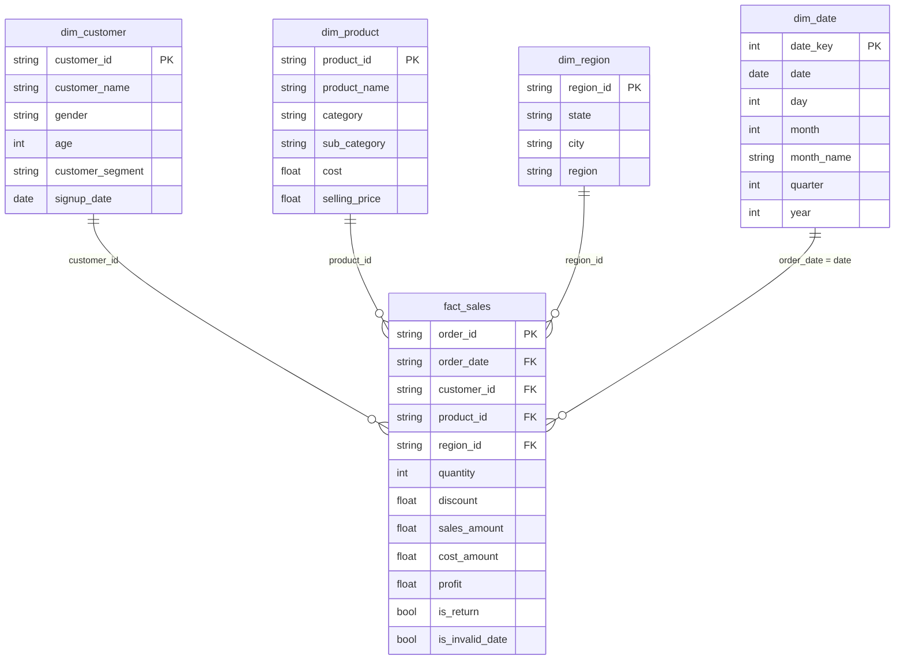

# Data model

A star schema with `fact_sales` at the centre. All four relationships are one-to-many, with the dimension on the "one" side.

## fact_sales (24,905 rows)

Grain: one row per order, and each order has one product.

| Column | Meaning |
|---|---|
| order_id | Primary key |
| order_date | `YYYY-MM-DD`, joins to `dim_date.date`. Blank for the 10 invalid dates |
| customer_id, product_id, region_id | Keys to the dimensions, never blank in this table |
| quantity | Units ordered. Negative for returns |
| discount | Fraction of list price, 0 to 0.20 |
| sales_amount | Revenue after discount. Negative for returns |
| cost_amount | Cost of goods sold |
| profit | Profit as supplied by the source |
| is_return | True when quantity is negative (15 rows) |
| is_invalid_date | True when the source date was not a valid date (10 rows) |

## dim_customer (2,000 rows)

| Column | Meaning |
|---|---|
| customer_id | Primary key |
| customer_name | Generic name, no analytical value |
| gender | Male, Female or Other |
| age | 18 to 65 |
| customer_segment | Consumer, Corporate or Small Business |
| signup_date | Corrected so it never falls after the customer's first order |

## dim_product (100 rows)

| Column | Meaning |
|---|---|
| product_id | Primary key |
| product_name | Product name |
| category | One of five standardized categories |
| sub_category | 15 sub-categories, each under exactly one category |
| cost, selling_price | List cost and list price per unit |

## dim_region (20 rows)

| Column | Meaning |
|---|---|
| region_id | Primary key |
| state | State name |
| city | Placeholder (state name plus "City") |
| region | North, South, East, West or Central |

## dim_date (731 rows)

| Column | Meaning |
|---|---|
| date_key | Primary key, integer `YYYYMMDD` |
| date | `YYYY-MM-DD` |
| day, month, quarter, year | Calendar parts |
| month_name | January to December |
